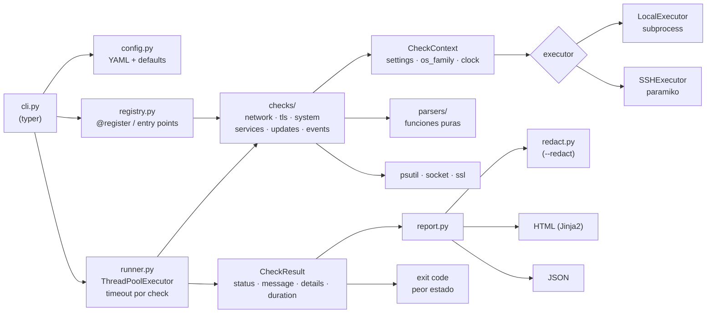

# server-diagnostics-toolkit


Toolkit de diagnóstico para servidores **Windows y Linux** pensado para soporte técnico L2/L3.
Corre una batería de checks (red, certificados TLS, recursos del sistema, servicios,
actualizaciones pendientes y errores recientes) y genera un **reporte HTML + JSON listo para
adjuntar a un ticket**. El exit code refleja el peor estado encontrado, así que también sirve
para correrlo programado o integrarlo con un sistema de monitoreo.

> Escenario típico: llega un ticket "la aplicación anda lenta / no conecta". En vez de pedirle
> al usuario capturas de pantalla, se corre `sysdiag run` y en 10 segundos queda documentado si
> el problema es DNS, un puerto bloqueado por firewall, un disco lleno, un servicio caído, un
> certificado vencido o un parche pendiente.

## Contenido

- [Características](#características)
- [Instalación](#instalación)
- [Uso](#uso)
- [Checks incluidos](#checks-incluidos)
- [Ejemplo de salida](#ejemplo-de-salida)
- [Configuración](#configuración)
- [Modo remoto (SSH)](#modo-remoto-ssh)
- [Scripts sin Python](#scripts-sin-python)
- [Programar la ejecución](#programar-la-ejecución)
- [Arquitectura](#arquitectura)
- [Desarrollo](#desarrollo)
- [Limitaciones conocidas](#limitaciones-conocidas)

## Características

- **12 checks** en 6 categorías, para Windows y Linux con la misma CLI.
- Reporte **HTML autocontenido** (sin CDNs, modo claro/oscuro, se puede imprimir a PDF) y **JSON** estructurado.
- Checks como **plugins** registrados con un decorador; paquetes externos pueden sumar checks por entry point.
- Ejecución **concurrente** (`ThreadPoolExecutor`) con **timeout por check**: un check colgado no frena al resto.
- **Exit code estilo Nagios** (0 OK, 1 WARN, 2 CRIT, 3 ERROR/UNKNOWN).
- Umbrales y targets en **YAML**.
- `--redact` para enmascarar hostname, usuario, IPs privadas y MACs antes de mandar el reporte a un proveedor externo.
- **Modo remoto** opcional por SSH (paramiko) para servidores Linux.
- Versiones **standalone** en PowerShell 5.1 y bash para servidores donde no se puede instalar Python.
- Parsers puros y testeados con salidas reales (ping en inglés y español, journald, Event Log, apt, dnf, systemctl).

## Instalación

Requiere Python 3.11 o superior.

```bash
git clone <url-del-repo> server-diagnostics-toolkit
cd server-diagnostics-toolkit
python -m venv .venv
source .venv/bin/activate          # Windows: .venv\Scripts\activate
pip install -r requirements.txt
pip install .                      # deja disponible el comando `sysdiag`
```

El modo remoto necesita `paramiko` (ya incluido en `requirements.txt`). Si se instala solo el
paquete: `pip install ".[remote]"`.

## Uso

```bash
# Correr todos los checks con los valores por defecto
sysdiag run

# Con configuración propia, guardando los reportes en otra carpeta
sysdiag run -c config/sysdiag.example.yaml -o C:\Tickets\INC0012345

# Solo algunos checks o categorías (separados por coma)
sysdiag run --only network,tls
sysdiag run --skip updates           # Windows Update puede tardar minutos

# Solo JSON por stdout (para pipelines o para pegar en el ticket)
sysdiag run --stdout-json --only disk,memory

# Enmascarar datos del equipo antes de compartir el reporte
sysdiag run --redact

# Otros comandos
sysdiag list-checks                  # lista los checks disponibles
sysdiag init-config sysdiag.yaml     # genera un YAML de ejemplo
sysdiag --version
```

También funciona como módulo: `python -m sysdiag run`.

### Exit codes

| Código | Estado | Significado |
|-------:|--------|-------------|
| 0 | OK | Todo dentro de los umbrales |
| 1 | WARN | Algo para revisar (disco al 80%, certificado vence en menos de 30 días) |
| 2 | CRIT | Problema concreto (servicio caído, puerto inaccesible, actualizaciones de seguridad) |
| 3 | ERROR | Algún check no pudo ejecutarse (comando inexistente, timeout, permisos) |

El estado general es el peor de todos con este orden de severidad: `OK < WARN < ERROR < CRIT`.
Un CRIT real pesa más que un check que no pudo correr.

## Checks incluidos

| Check | Categoría | Qué revisa | Windows | Linux | SSH |
|-------|-----------|------------|:-------:|:-----:|:---:|
| `dns` | network | Resolución de una lista de nombres y tiempo de respuesta | ✔ | ✔ | |
| `tcp_ports` | network | Conexión TCP a `host:puerto`; distingue **rechazado** (servicio caído) de **timeout** (firewall) | ✔ | ✔ | |
| `ping` | network | Latencia y pérdida de paquetes; parsea la salida de `ping` en inglés y español | ✔ | ✔ | |
| `gateway` | network | Gateway por defecto (`route print` / `ip route`) y si responde a ping | ✔ | ✔ | |
| `tls_certs` | tls | Días hasta el vencimiento, cadena válida y coincidencia de nombre | ✔ | ✔ | |
| `disk` | system | Uso por partición (ignora tmpfs, squashfs, lectoras ópticas) | ✔ | ✔ | ✔ |
| `memory` | system | Uso de RAM y swap | ✔ | ✔ | ✔ |
| `cpu` | system | Uso de CPU (muestra de 1 s) y load average | ✔ | ✔ | ✔ |
| `uptime` | system | Reinicio reciente inesperado o servidor sin reiniciar hace meses | ✔ | ✔ | ✔ |
| `services` | services | Servicios requeridos detenidos (`psutil.win_service_iter` / `systemctl is-active`) y unidades systemd en `failed` | ✔ | ✔ | ✔ |
| `updates` | updates | Pendientes de Windows Update (API COM + `Get-HotFix`), apt o dnf/yum, separando las de seguridad | ✔ | ✔ | ✔ |
| `recent_errors` | events | Errores y críticos del Event Log (`Get-WinEvent`) o de journald (`journalctl -p err`) normalizados a un modelo común | ✔ | ✔ | ✔ |

Algunos detalles que suelen marcar la diferencia en soporte:

- **Ping en Windows**: `Destination host unreachable` cuenta como respuesta recibida con 0% de pérdida.
  El parser lo detecta y lo toma como paquete perdido.
- **Encoding en Windows**: los comandos nativos (`ping`, `route`) se decodifican con la página de códigos
  OEM de la consola (cp850 en equipos en español) y PowerShell se fuerza a UTF-8 para no romper acentos.
- **Errores de PowerShell**: el stderr en formato CLIXML se convierte a un mensaje legible. Si `Get-WinEvent`
  falla por RPC, el reporte sugiere revisar si el servicio EventLog está detenido.
- **Linux**: todos los comandos se corren con `LC_ALL=C` para que la salida sea parseable sin importar el idioma.

## Ejemplo de salida

Consola:

```text
$ sysdiag run -c config/sysdiag.example.yaml
sysdiag 0.1.0 · srv-app-01 · 12 checks

  CRIT   dns            No resuelven: intranet.example.local
  OK     gateway        Gateway 10.0.0.1 responde (14 ms)
  OK     ping           8.8.8.8 14 ms/0% loss; 1.1.1.1 10 ms/0% loss
  CRIT   tcp_ports      Sin acceso: db01.example.local:5432: timeout (posible firewall)
  WARN   tls_certs      portal.example.com vence en 13 días
  OK     cpu            CPU al 23% (4 cores)
  WARN   disk           / al 82% (9.0 GiB libres)
  OK     memory         Memoria al 61% (6.2 de 16.0 GiB disponibles)
  OK     uptime         Uptime 12d 5h 0m
  CRIT   services       Servicios con problemas: nginx (failed), certbot-renew.timer (failed)
  CRIT   updates        4 actualizaciones pendientes (3 de seguridad)
  WARN   recent_errors  4 errores en las últimas 24 h (más frecuente: sshd x2), 1 críticos

Estado general: CRIT (exit code 2)
Reporte: reports/sysdiag-srv-app-01-20261028-093000.json
Reporte: reports/sysdiag-srv-app-01-20261028-093000.html
```

Reportes de ejemplo completos: [`docs/sample-report.html`](docs/sample-report.html) y
[`docs/sample-report.json`](docs/sample-report.json). Se generan con datos ficticios
(`python docs/generate_sample.py`) corriendo el pipeline real con las dependencias externas mockeadas.

Fragmento del JSON:

```json
{
  "generated_at": "2026-10-28T09:30:00+00:00",
  "host": { "hostname": "srv-app-01", "os_family": "linux", "mode": "local" },
  "overall_status": "CRIT",
  "exit_code": 2,
  "summary": { "OK": 5, "WARN": 3, "CRIT": 4, "ERROR": 0 },
  "results": [
    {
      "status": "WARN",
      "message": "portal.example.com vence en 13 días",
      "details": {
        "items": [
          { "host": "portal.example.com", "status": "WARN", "days_left": 13.1, "expires": "2026-11-10" }
        ]
      },
      "name": "tls_certs",
      "category": "tls",
      "duration_ms": 42.0
    }
  ]
}
```

## Configuración

Todo es opcional: lo que no esté en el YAML toma el valor por defecto
([`src/sysdiag/config.py`](src/sysdiag/config.py)). Ejemplo comentado completo en
[`config/sysdiag.example.yaml`](config/sysdiag.example.yaml).

```yaml
timeout_seconds: 30          # timeout por check
checks:
  tcp_ports:
    targets: [sql01.corp.local:1433, dc01.corp.local:389]
  tls_certs:
    hosts: [portal.example.com, api.example.com:8443]
    warn_days: 30
    crit_days: 7
  disk:
    warn_pct: 80
    crit_pct: 90
  services:
    windows: [MSSQLSERVER, W3SVC, Spooler]
    linux: [nginx, postgresql]
  updates:
    timeout_seconds: 300     # override por check
  recent_errors:
    enabled: false           # cualquier check se puede apagar
```

## Modo remoto (SSH)

Corre los checks que solo dependen de comandos (`disk`, `memory`, `cpu`, `uptime`, `services`,
`updates`, `recent_errors`) contra un host Linux por SSH. Los checks de red y TLS se omiten porque
medirían la red del equipo local, no la del servidor.

```bash
sysdiag run --remote admin@db01.corp.local --key ~/.ssh/id_ed25519
SSH_PASS='...' sysdiag run --remote admin@db01 --password-env SSH_PASS
```

Por seguridad rechaza hosts que no estén en `known_hosts`; `--accept-unknown-host` lo permite
mostrando un warning. En remoto se usan `df` y `/proc` en lugar de psutil, con los mismos parsers
que están testeados.

## Scripts sin Python

Para servidores donde no se puede instalar nada:

| Script | Requisitos | Salida |
|--------|------------|--------|
| [`scripts/Invoke-QuickDiag.ps1`](scripts/Invoke-QuickDiag.ps1) | Windows PowerShell 5.1+ | JSON por stdout o `-OutFile` |
| [`scripts/quick_diag.sh`](scripts/quick_diag.sh) | bash, coreutils, iproute2 (opcional: openssl, systemd) | JSON por stdout o `-o` |

Cubren los mismos checks (el de PowerShell suma la detección de **reinicio pendiente** vía registro)
y devuelven el mismo esquema de JSON y los mismos exit codes.

```powershell
# Windows: -File devuelve el exit code real del script
powershell -NoProfile -ExecutionPolicy Bypass -File .\scripts\Invoke-QuickDiag.ps1 -SkipUpdates -OutFile C:\Temp\diag.json

# Para pasar listas hay que usar -Command (con -File no se separan por coma)
powershell -NoProfile -ExecutionPolicy Bypass -Command "& .\scripts\Invoke-QuickDiag.ps1 -TcpTargets 'sql01:1433','dc01:389' -Services 'MSSQLSERVER','W3SVC'; exit $LASTEXITCODE"
```

```bash
# Linux
./scripts/quick_diag.sh -t "db01:5432,api01:443" -s "nginx,postgresql" -c "portal.example.com" -o /tmp/diag.json
```

## Programar la ejecución

### Linux (cron)

```cron
# Todos los días a las 7:00, guardando reportes y un log con el exit code
0 7 * * * /opt/sysdiag/.venv/bin/sysdiag run -c /etc/sysdiag.yaml -o /var/log/sysdiag -q; echo "$(date -Is) exit=$?" >> /var/log/sysdiag/cron.log
```

Con systemd timer se puede usar `OnCalendar=*-*-* 07:00:00` y revisar el resultado con
`systemctl status sysdiag.service` (el exit code distinto de 0 deja la unidad en `failed`).

### Windows (Programador de tareas)

```powershell
$action  = New-ScheduledTaskAction -Execute 'C:\sysdiag\.venv\Scripts\sysdiag.exe' `
           -Argument 'run -c C:\sysdiag\sysdiag.yaml -o C:\sysdiag\reports -q'
$trigger = New-ScheduledTaskTrigger -Daily -At 7am
Register-ScheduledTask -TaskName 'sysdiag diario' -Action $action -Trigger $trigger `
    -User 'SYSTEM' -RunLevel Highest
```

O con `schtasks`:

```bat
schtasks /Create /TN "sysdiag diario" /SC DAILY /ST 07:00 /RU SYSTEM /RL HIGHEST ^
  /TR "C:\sysdiag\.venv\Scripts\sysdiag.exe run -c C:\sysdiag\sysdiag.yaml -o C:\sysdiag\reports -q"
```

El "Último resultado" de la tarea muestra el exit code (0x1 WARN, 0x2 CRIT, 0x3 ERROR). Conviene
correrlo como SYSTEM o administrador: algunos servicios y canales del Event Log no se pueden leer
con un usuario común.

### Integración con monitoreo

Como el exit code sigue la convención de Nagios, se puede usar directamente como check en
Nagios, Icinga, Zabbix (`system.run`) o PRTG (sensor EXE/Script):

```bash
sysdiag run --only disk,services -q -f json -o /tmp/sysdiag
```

## Arquitectura



Decisiones de diseño:

- **Parsers separados de los checks.** Toda la lógica de interpretar salidas (`ping`, `route print`,
  `apt`, `dnf`, `journalctl`, `Get-WinEvent`, `systemctl`, `df`) son funciones puras en
  `sysdiag/parsers/`, testeadas con fixtures de salidas reales.
- **Los checks no llaman a `subprocess`.** Reciben un executor en el contexto. Eso permite que el
  mismo check corra local o por SSH, y que los tests inyecten respuestas sin mockear `subprocess`.
- **Un check roto no rompe el reporte.** Cualquier excepción se convierte en un resultado `ERROR`
  con el mensaje, y el resto de los checks sigue.
- **Timeout por check.** Cada check tiene un deadline propio; si se vence se reporta `ERROR` y el
  runner sigue. Además todos los comandos externos y sockets tienen su propio timeout.
- **Checks como plugins.** Un paquete externo puede registrar checks propios:

  ```toml
  # pyproject.toml del paquete externo
  [project.entry-points."sysdiag.checks"]
  mi_empresa = "mi_paquete.checks"
  ```

  ```python
  from sysdiag.models import CheckResult, Status
  from sysdiag.registry import register


  @register(
      "iis_app_pools",
      category="services",
      description="App pools de IIS detenidos",
      platforms=("windows",),
  )
  def check_app_pools(ctx):
      ...
      return CheckResult(Status.OK, "Todos los app pools iniciados")
  ```

## Desarrollo

```bash
python -m venv .venv
source .venv/bin/activate            # Windows: .venv\Scripts\activate
pip install -r requirements-dev.txt  # instala el paquete en modo editable + pytest + ruff

pytest                               # tests (todo lo externo está mockeado)
pytest --cov                         # con cobertura
ruff check . && ruff format --check .
python docs/generate_sample.py       # regenera los reportes de ejemplo
```

En Linux/macOS hay atajos en el `Makefile` (`make install`, `make lint`, `make test`, `make cov`).

Los tests no tocan la red ni el sistema: `psutil`, `subprocess`, `socket` y `ssl` están mockeados, y
las salidas de comandos vienen de [`tests/fixtures/`](tests/fixtures) (ping de Windows en inglés y
español, ping de Linux e iputils/busybox, `journalctl -o json`, `Get-WinEvent` serializado por
PowerShell 5.1 y 7, `apt list --upgradable`, `dnf check-update`, `dnf updateinfo`, `systemctl`, `df`,
`/proc/meminfo`, `route print`, `ip route`).

CI ([`.github/workflows/ci.yml`](.github/workflows/ci.yml)):

- `lint`: ruff check + ruff format.
- `test`: pytest en Ubuntu con Python 3.11, 3.12 y 3.13, y en Windows con 3.12.
- `powershell`: PSScriptAnalyzer sobre `scripts/` y ejecución real de `Invoke-QuickDiag.ps1` en Windows PowerShell 5.1.
- `bash`: `bash -n` + shellcheck y ejecución real de `quick_diag.sh` validando el JSON.

### Estructura

```text
server-diagnostics-toolkit/
├── .github/workflows/ci.yml
├── config/sysdiag.example.yaml
├── docs/
│   ├── generate_sample.py
│   ├── sample-report.html
│   └── sample-report.json
├── scripts/
│   ├── Invoke-QuickDiag.ps1
│   └── quick_diag.sh
├── src/sysdiag/
│   ├── checks/          # network, tls, system, services, updates, events
│   ├── parsers/         # funciones puras: ping, network, linux, updates, events
│   ├── templates/       # report.html.j2 + config de ejemplo para init-config
│   ├── cli.py           # comandos run, list-checks, init-config
│   ├── config.py        # YAML + defaults
│   ├── context.py       # CheckContext
│   ├── executor.py      # LocalExecutor, helpers de PowerShell
│   ├── hostinfo.py
│   ├── models.py        # Status, CheckResult, EventRecord, PendingUpdate
│   ├── redact.py
│   ├── registry.py      # @register + entry points
│   ├── remote.py        # SSHExecutor (paramiko)
│   ├── report.py        # JSON + HTML
│   └── runner.py        # ejecución concurrente con timeout
├── tests/
│   ├── fixtures/
│   └── test_*.py
├── Makefile
├── pyproject.toml
├── requirements.txt
└── requirements-dev.txt
```

## Limitaciones conocidas

- **Los hilos no se pueden matar en Python.** Si un check supera su timeout se reporta como `ERROR`,
  pero el hilo sigue hasta que termine su comando (que siempre tiene su propio timeout). Por eso el
  proceso puede tardar un poco más que el timeout en salir en el peor caso.
- **Windows Update** usa la API COM, que puede tardar varios minutos y necesita el servicio
  `wuauserv` habilitado. En equipos administrados por WSUS refleja lo aprobado en WSUS.
- **apt** no ejecuta `apt update` (requiere root): informa según la caché actual de paquetes.
- **DNS** usa el resolver del sistema (`getaddrinfo`); no permite elegir un servidor DNS puntual.
- **Certificados**: valida contra el almacén de CAs del sistema. Para CAs internas hay que indicar
  `cafile` en la configuración; los certificados autofirmados se reportan como `CRIT`.
- El **modo remoto** solo soporta hosts Linux con systemd y no corre los checks de red/TLS.
- `--redact` enmascara lo que puede detectar (hostname, usuario actual, IPs de las interfaces locales,
  IPs privadas, MACs). Conviene revisar el reporte antes de enviarlo afuera de la organización.
